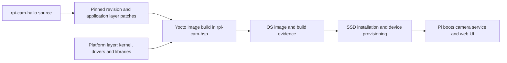

# Raspberry Pi Camera OS Image

This repository, **rpi-cam-bsp**, builds the embedded Linux OS image for a
Raspberry Pi 5 network camera. It is one half of a paired system: this project
provides the operating system and hardware integration, while
[**rpi-cam-hailo**](https://github.com/many9381/rpi-cam-hailo) provides the camera
application firmware and browser interface. Together they turn a Raspberry Pi,
camera module and optional Hailo accelerator into a bootable camera appliance.

Here, **application firmware** means the C++ camera service and its web UI
running on Linux. The OS image also contains the kernel, drivers, libraries
and services needed to run that firmware.
**BSP** stands for *board support package*: the platform-specific integration
that lets the OS use the board and its peripherals.

## How the two projects fit together

| Project | Owns | Produces |
|---|---|---|
| **rpi-cam-bsp** — this repository | Yocto layers, boot configuration, kernel and drivers, runtime packages, image building, SSD installation and device provisioning | A bootable OS image, package/SPDX manifests and build provenance |
| [**rpi-cam-hailo**](https://github.com/many9381/rpi-cam-hailo) | Capture and encoding, Hailo inference, secure streaming, accounts, settings, audit records and web UI | The camera application, supporting tools and static web assets, packaged by this repository |



The repositories keep separate Git histories. A local `rpi-cam-hailo/`
checkout is convenient for development and is ignored by this repository;
it is not a submodule. Recipes build an immutable source revision plus
reviewed patches. Editing that checkout alone does **not** change the next
image. See [application integration](docs/runbooks/camera-firmware.md).

## Start here

| Your task | Start with |
|---|---|
| Use an already installed camera | [First boot and everyday use](https://github.com/many9381/rpi-cam-hailo#first-boot-and-everyday-use) |
| Build an image and install it on SSD | [Build and install](#build-and-install) below |
| Change the kernel, drivers, packages or provisioning | This repository and its [runbooks](#developer-guide) |
| Change camera behavior, AI or the web UI | The [firmware repository](https://github.com/many9381/rpi-cam-hailo) |
| Understand Pi 5 performance constraints or TTA preparation | The firmware README's [architecture](https://github.com/many9381/rpi-cam-hailo#raspberry-pi-5-architecture-and-limits) and [certification status](https://github.com/many9381/rpi-cam-hailo#tta-certification-preparation) |

## Supported hardware and image profiles

The validated hardware is a **Raspberry Pi 5**, **Camera Module 3 Wide
(IMX708)**, USB SSD boot and an optional **Hailo-8** accelerator. The system
runs headless; users operate it through a browser or key-authenticated SSH.
The OS is built with pinned **Yocto 6.0 (`wrynose`)** inputs for AArch64.

| Profile | Purpose |
|---|---|
| `rpi5-minimal` | Base OS for boot, networking and SSH bring-up |
| `rpi5-camera` | Base OS plus the camera application and web UI, without Hailo packages |
| `rpi5-camera-hailo` | Integrated camera system with HailoRT, the PCIe driver and a detection model; default for `build-image.sh` |
| `qemu` | Optional emulated base-system checks; cannot validate the Pi camera or Hailo hardware |

Pi 5 capture uses the hardware ISP through libcamera; H.264 encoding uses
CPU-based x264. Hailo accelerates neural-network inference, not video
encoding. The firmware [architecture guide](https://github.com/many9381/rpi-cam-hailo#raspberry-pi-5-architecture-and-limits)
explains the resulting scheduling, buffering and performance trade-offs.

As of **2026-10-17**, integrated image `20261017T051814Z-63b1d2587b1b`
has passed installed-file checks and three Wi-Fi reboot cycles, with video
and Hailo detections confirmed by the operator. Wi-Fi, fan control and Codex
operation were also checked. Its 368 packages exclude target compilers and
development headers while retaining required runtime libraries. See
[current validation records](docs/runbooks/camera-firmware.md#current-validated-image-and-dependency-records).
This acceptance belongs to that image; it does not automatically validate a
later build or constitute TTA certification.

## Build and install

### 1. Prepare the build PC and local inputs

Use an x86_64 Ubuntu 24.04 build PC. Follow
[host setup](docs/runbooks/build-qemu.md#one-time-host-setup) for packages,
Python 3.12, the pinned uv/kas environment, resources and SSH keys. Work from
this repository's root as the normal build user.

Prepare these inputs before the first Hailo build:

- SSH access and the local administrator key, as described in host setup.
- HailoRT **4.24.0** packages, model and source access, following
  [firmware integration](docs/runbooks/camera-firmware.md). Vendor `.deb`
  files belong in their documented layer recipe `files/` directories.
- Optional [Wi-Fi configuration](docs/runbooks/wifi.md) for automatic connection.
- The intended USB SSD's registration in `keys/ssd-target.json`, following
  [SSD installation](docs/runbooks/usb-ssd-bringup.md#automatic-development-installation).
- A valid local Codex login for the default credential-restoration path, or
  the documented `--skip-codex-auth` installation option. See
  [Codex provisioning](docs/runbooks/codex.md).

Private keys, login sessions, vendor packages and local configuration stay
outside Git. A Wi-Fi-provisioned image contains the Wi-Fi credential and
must remain private.

### 2. Build a new image

```bash
./scripts/build-image.sh
```

The launcher creates a fresh build ID and builds `rpi5-camera-hailo`. It
collects the image, manifests and provenance under
`artifacts/<build-id>/rpi5-camera-hailo/`. A `COMPLETE` marker means that build
and artifact collection finished; device validation is a separate step.

To resume an interrupted build, reuse its printed ID and environment options:

```bash
./scripts/build.sh --build-id BUILD_ID rpi5-camera-hailo build
```

`BUILD_ID` is a placeholder for the actual ID. The lower-level `build.sh`
also supports the other profiles; without `--build-id`, it reads
`.state/active-build-id`. Starting `build-image.sh` again creates a new run.

### 3. Install on the registered SSD

Connect the target SSD to the build PC, then run:

```bash
./scripts/install-ssd.sh --check
./scripts/install-ssd.sh
```

**Installation replaces the registered SSD's contents, including existing
camera accounts and settings.** `--check` performs read-only preflight.
The installer selects the latest completed Hailo image, checks the registered
disk identity and checksums, unmounts the target, writes and verifies it,
provisions the camera, and unmounts it again. Run without `sudo`; the script
requests elevated access for disk operations. Wait for its safe-to-disconnect
result before moving the SSD to the Pi.

Device provisioning creates TLS/SRTP material and a signed configuration,
and seeds the initial time floor. The default Codex restoration writes the
build user's login onto the SSD, outside the image, build caches and Git.
See the [installation runbook](docs/runbooks/usb-ssd-bringup.md) for image
selection, credential options and recovery modes.

### 4. Boot and complete setup

Boot the Pi from the SSD and find its Ethernet or Wi-Fi address. Open
`https://<current-Pi-IP>:8443/`, use the initial account displayed by the app,
and complete the administrator setup. Check live video and, with Hailo,
`hailo / ready`, increasing inference frames and object labels/confidence.

The Pi's future DHCP address need not be registered in advance. Management
IP restrictions are optional and refer to connecting clients. The bootstrap
certificate is self-signed; trusted TLS access needs appropriate certificate
and name provisioning. See the firmware's
[first-boot guide](https://github.com/many9381/rpi-cam-hailo#first-boot-and-everyday-use).

## Developer guide

| Path | Responsibility |
|---|---|
| `meta-rpi5-cam/` | Platform support, kernel changes, hardware packages and base images |
| `meta-rpi-cam-hailo/` | Application, web, model and development-checkout recipes; integration patches |
| `kas/` | Layer revisions and image profiles |
| `scripts/` | Guarded build, install, provisioning and validation entry points |
| `tests/host/`, `tests/integration/` | Host contracts and integration checks |
| `docs/runbooks/` | Setup, maintenance and validation procedures |
| `artifacts/`, `.state/`, `keys/` | Local outputs, private evidence and provisioning inputs; excluded from Git except documented public files |

The C++ application is cross-compiled on the build PC. Web assets are built
with host Node.js and served as static files on the Pi; the device needs no
Node.js server. Target GCC/G++, headers, CMake and Ninja are excluded by
default. `RPI5_LOCAL_BUILDTOOLS=1` selects the separate development package
group; its optional image/device validation is excluded from current work by
agreement. See [optional build tools](docs/runbooks/local-buildtools.md).

Camera profiles explicitly select Codex CLI for development/review; it is
not a firmware runtime dependency. An editable source checkout is installed
at `/home/rpiadmin/rpi-cam-hailo`; set `RPI_CAM_HAILO_DEV_REPO=0` to omit it.
See [development checkout](docs/runbooks/camera-firmware.md#optional-development-repository-in-rpiadmins-home)
and [Codex on the camera](docs/runbooks/codex.md).

Use the root checkout for ongoing development. Keep the existing historical
`.worktrees/yocto-implementation` outputs and evidence separate; do not reuse
its old launchers or PASS markers for a new image. Do not create or switch
to another worktree unless explicitly requested.

The documented integration policy uses `develop`, with independently testable
changes on `feature/SCOPE`. Write commit messages in English with a
Conventional Commit subject. `master` receives only a fully accepted and
explicitly approved release baseline.

## Validation and further reading

Routine integrated builds and SSD installation do **not** require a QEMU
image or a repeated minimal-image run. QEMU validation is optional. Yocto
may still use `qemu-native` as a build-host tool; that is separate from building
and booting an emulated OS image.

For the formal minimal-then-camera release route, use one unchanged revision
and build ID: minimal-image USB/network/SSH/reboot acceptance, followed by
camera capture/encoding/thermal/transfer/reboot acceptance. This route has
two planned hands-on SSD sessions. It is separate from routine Hailo image
installation. Runbooks:

1. [Host setup and optional QEMU checks](docs/runbooks/build-qemu.md)
2. [SSD installation](docs/runbooks/usb-ssd-bringup.md)
3. [Remote Pi validation](docs/runbooks/remote-validation.md)
4. [Camera validation](docs/runbooks/camera-validation.md)
5. [Application provisioning and integration](docs/runbooks/camera-firmware.md)
6. [Build provenance](docs/runbooks/build-provenance.md) and [evidence schema](docs/evidence-schema.md)

TTA preparation, source analysis and vulnerability dispositions are maintained
in the firmware repository's [security evidence index](https://github.com/many9381/rpi-cam-hailo/blob/master/docs/security/README.md).
The projects' exclusions include endurance testing and the separately
opted-in development-image validation; retain those boundaries when reporting
coverage. Before distributing an image, follow the
[H.264 licensing gate](docs/licensing/camera-h264.md).
[EEPROM recovery](docs/runbooks/eeprom-recovery.md) is an exception path.

Do not commit generated images, private evidence, login keys or sessions,
actual site IP addresses or device identifiers. Publish only reviewed,
sanitized evidence in the formats allowed by the evidence schema.
